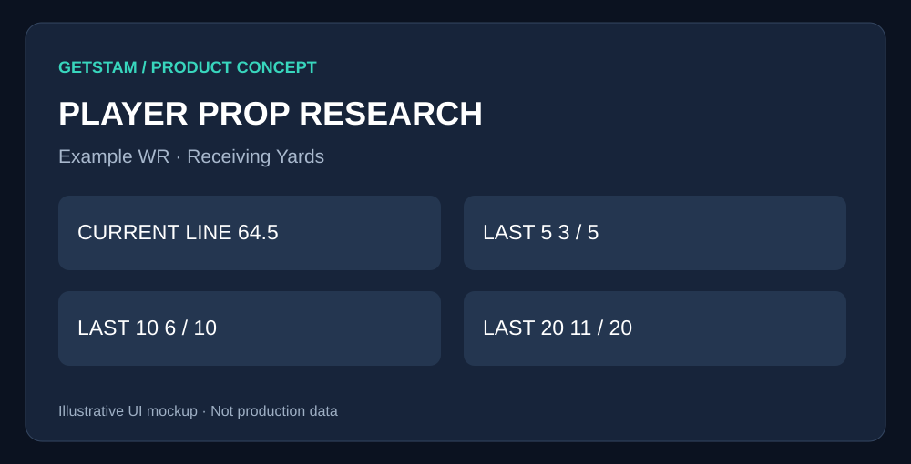

# Advanced Player Prop Analyzer

> **GetSTAM product specification** · Draft for review · October 2026  
> **Visuals are conceptual mockups, not production screenshots or live data.**

## 1. Overview

Help users compare today's sportsbook lines against actual historical player performances.

## 2. Proposed user interface



*Figure 1 — Proposed GetSTAM interface. Visual elements and figures are illustrative.*

### How a user would experience this

Choose sport, game, player and prop; inspect hit counts against the selected line; expand each game result; adjust opponent and venue filters.

## 3. Feature comparison

| Feature | Free | GetSTAM Pro |
|---|---|---|
| Recent game logs | Last 5 | Last 5 / 10 / 20 and more |\n| Opponent and venue splits | — | Yes |\n| Custom line comparison | Preview | Yes |\n| Saved research | — | Yes |

## 4. Product and implementation notes

Audit player IDs, game dates, line units and market availability. Calculate counts in backend. Never describe historical outcomes against today's line as actual past betting returns.

## 5. Acceptance criteria

Historical results link to underlying games; pushes and missing observations handled; mobile design and tests included.

## 6. Detailed technical planning

# 02 — Advanced Player Prop Analyzer

**Status:** Proposed · **Priority:** P1 · **Audience:** Sports research users

## Goal
Make GetSTAM's historical player prop data useful for researching today's sportsbook lines, with reproducible historical results and context.

## User experience
1. Select sport, game, player and market (e.g. passing yards, points, shots).
2. Show today's line, bookmaker, odds, and update timestamp.
3. Show last 5 / 10 / 20 game outcomes versus the **selected line**, with wins, losses, pushes, and sample sizes.
4. Compare home/away, opponent, season, and minutes/snaps/playing-time splits when supported.
5. Open underlying game log and show which observations are missing or excluded.

## Example UI (illustrative)
```text
PLAYER PROP RESEARCH  | NFL | WR Receiving Yards
Player: Example WR       Book: Example Book
Current line: Over 64.5 (-110) / Under 64.5 (-110)
Last 5: 3/5 over 64.5     Last 10: 6/10     Last 20: 11/20
[Game-by-game bar chart] [Opponent filter] [Home/Away filter]
Evidence: date | opponent | stat | line compared | result
```

## Free vs Pro
- **Free:** A basic recent-games view and limited market coverage.
- **Pro:** Longer history, matchup and contextual filters, advanced comparisons, saved research, and export.
- Do not gate existing free functionality retroactively without a deliberate product decision.

## Data and implementation
- Audit available historical player props and current Odds API market coverage before specifying supported sports.
- Normalize player/team IDs, market units, line thresholds, push handling, timestamps, and source.
- Separate historical actuals from historical sportsbook lines: comparing past actuals to **today's** line is not a historical bet-performance backtest.
- Show missing data and avoid survivorship bias; handle trades, injuries, doubleheaders, postponements, and player aliases.
- Cache frequent lookups; measure API usage and licensing restrictions.

## Acceptance criteria
- Results can be traced to individual completed games.
- No invented lines, props, or historical prices.
- Correct > / < / = line treatment, including pushes.
- Mobile-friendly charts and loading/empty/error states.
- Tests for player matching, line comparisons, and data gaps.
- Instrument view-to-signup and free-to-Pro conversion.

## Open decisions
Supported sports and markets; historical coverage; data rights; free usage limits; exact Pro entitlement; design approval.

## Related work
[Product roadmap](05-product-roadmap.md) · [GetSTAM Pro](03-getstam-pro.md) · [AI Research Assistant](04-ai-research-assistant.md)

---

**Review checklist:** Confirm feature scope, visual design, free/paid boundary, and acceptance criteria before implementation.
