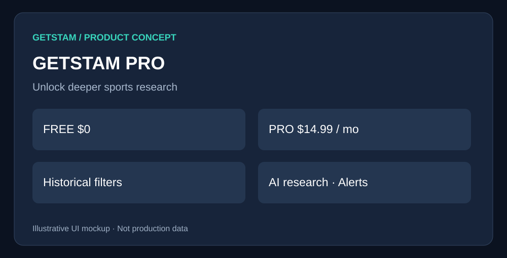

# GetSTAM Pro Subscription

> **GetSTAM product specification** · Draft for review · October 2026  
> **Visuals are conceptual mockups, not production screenshots or live data.**

## 1. Overview

Give subscribers faster, deeper research while preserving the existing free GetSTAM experience.

## 2. Proposed user interface

*Figure 1 — Proposed GetSTAM interface. Visual elements and figures are illustrative.*

### How a user would experience this

From an advanced research preview, open a plan comparison, choose Pro, complete checkout, and return to the original research page.

## 3. Feature comparison

| Feature | Free | GetSTAM Pro |
|---|---|---|
| Live scores and odds | Yes | Yes |\n| Existing team trends | Yes | Yes |\n| Last five games and H2H | Yes | Yes |\n| Basic advanced trends | Yes | Yes |\n| Trend collision details | Preview | Full |\n| Advanced historical filters | — | Yes |\n| Player prop research | Limited | Full |\n| Custom alerts | — | Yes |\n| AI research assistant | — | Usage allowance |\n| Saved research | — | Yes |

## 4. Product and implementation notes

Proposed test price: **$14.99/month**, not validated. Use hosted checkout, verified billing webhooks, backend entitlements, cancellation flow, and quota enforcement.

## 5. Acceptance criteria

Free features remain accessible; direct API calls respect entitlements; billing retries, cancellations and refunds tested.

## 6. Detailed technical planning

# 03 — GetSTAM Pro: Monetization and Entitlements

**Status:** Proposed · **Priority:** P2 (after proving research value)

## Goal
Create a paid subscription for time-saving sports research workflows while preserving the core free product.

## Initial packaging proposal
| Capability | Free | Pro |
|---|---|---|
| Live scores and odds | Yes | Yes |
| Existing basic trends and game history | Yes | Yes |
| Basic advanced trend overview | Yes | Yes |
| Advanced player prop filters | Preview | Full |
| Custom trend collision explorer | Preview | Full |
| Saved research and watchlists | Limited | Full |
| Custom trend / line alerts | No | Yes |
| AI research assistant | Limited or trial | Monthly quota |

**Hypothesis to test:** $14.99/month. This is a proposed price, not validated demand. Consider annual pricing only after observing retention.

## User journeys
1. User sees valuable free research.
2. Locked advanced filter shows a transparent preview and explains the benefit.
3. User chooses Pro, completes hosted checkout, and returns to the same research view.
4. Account receives entitlements via verified webhook; billing portal supports cancellation and invoices.
5. Expired/canceled users retain free access and their account history under a clear retention policy.

## Technical architecture
- Centralized backend entitlement checks; never rely on frontend hiding alone.
- Stripe Checkout, Customer Portal, verified webhooks, idempotent event processing.
- Subscription state reconciled against Stripe; handle retries, charge failures, refunds, and delayed webhooks.
- Feature flags for staged rollout, trial experiments, and rollback.
- Quotas enforced server-side for costly AI/API workflows.
- Protect personal data, minimize stored billing information, and publish clear terms and privacy disclosures.

## Metrics
Free-to-paid conversion, activation, retention, churn, MRR, refund rate, API/LLM cost per subscriber, and contribution margin. Track by cohort.

## Acceptance criteria
- Core free pages remain usable without payment.
- Paid access cannot be bypassed by direct API calls.
- Cancellation, failed payment, and webhook replay behave correctly.
- Mobile checkout and accessibility tested.
- Billing support and clear plan terms available before launch.

## Risks and decisions
Validate willingness to pay with a landing page/waitlist or small beta first. Confirm data licensing permits commercial redistribution and analytics. Consider legal review of gambling-adjacent marketing and geographic restrictions.

## Related work
[Player Props](02-player-props.md) · [AI Assistant](04-ai-research-assistant.md) · [Roadmap](05-product-roadmap.md)

---

**Review checklist:** Confirm feature scope, visual design, free/paid boundary, and acceptance criteria before implementation.
