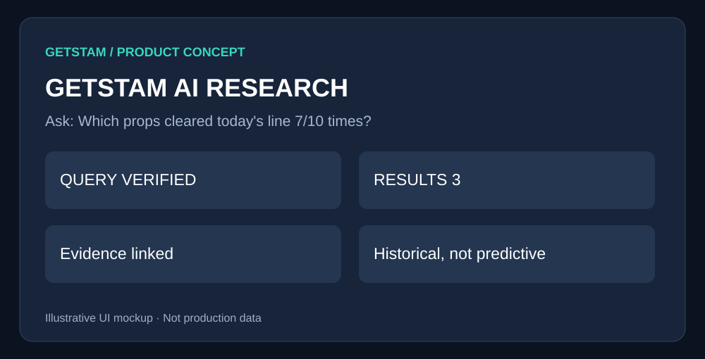

# AI Research Assistant

> **GetSTAM product specification** · Draft for review · October 2026  
> **Visuals are conceptual mockups, not production screenshots or live data.**

## 1. Overview

Let users ask sports research questions in natural language and inspect the evidence behind every answer.

## 2. Proposed user interface



*Figure 1 — Proposed GetSTAM interface. Visual elements and figures are illustrative.*

### How a user would experience this

Type a research question, see the interpreted filters, receive matching players or games, and expand each result to verify dates, lines and samples.

## 3. Feature comparison

| Feature | Free | GetSTAM Pro |
|---|---|---|
| Example queries | Limited | More queries |\n| Game-level citations | Yes | Yes |\n| Advanced prop filters | — | Yes |\n| Saved conversations | — | Yes |\n| Custom research alerts | — | Future phase |

## 4. Product and implementation notes

Use typed tool calls into GetSTAM data; deterministic Python/SQL calculations; sourced answers; quotas and audit logging. Do not equate past hit rates with predicted probabilities.

## 5. Acceptance criteria

No fabricated data, each numerical answer verifiable, clear unsupported-query handling, prompt-injection and cost tests.

## 6. Detailed technical planning

# 04 — AI Betting Research Assistant

**Status:** Proposed · **Priority:** P2 · **Positioning:** Evidence-backed research, not guaranteed picks

## Goal
Let users query GetSTAM's historical games, trends, player props, and current lines in plain English and receive auditable, sourced research.

## Example prompts
- “Find NFL receiving props with at least 7 overs in the last 10 games relative to today's line.”
- “Compare this MLB pitching matchup using recent ERA, innings, and opponent splits.”
- “Show where the historical trends for tonight's matchup disagree.”

## Proposed UX
```text
Ask GetSTAM AI: [Research a game, player, or market...]
Filters: NFL | Player props | Last 10 | Minimum sample: 8
Answer: 3 matching results
[Player / Market] [Current line] [Historical count] [Data freshness]
Why it matched: explicit filters and game-level evidence
Caveats: injuries, missing games, line movement, small samples
[Open evidence] [Save research]
```

## Architecture
1. Parse question into a typed query plan.
2. Use allowlisted tools to fetch current odds, historical stats, and trends.
3. Calculate aggregates deterministically in Python/SQL rather than relying on model arithmetic.
4. Validate tool outputs, timestamps, data completeness, and sample sizes.
5. Compose explanation with direct links to game logs and source data.
6. Log anonymized evaluation traces, latency, errors, and cost; enforce rate limits and entitlements.

## Trust and safety
- Do not claim historical hit rate equals future win probability.
- Avoid “guaranteed,” “lock,” and unsupported expected-value claims.
- Disclose uncertainty, sample overlap, and missing data.
- Separate informational analysis from placing bets; no automated wagering in v1.
- Prevent prompt injection from retrieved text and keep secrets out of model context.
- Provide age-appropriate and jurisdiction-appropriate responsible gambling notices.

## Phased release
- **V1:** Read-only, one sport, limited query templates and cited game evidence.
- **V2:** More markets, follow-up questions, saved searches.
- **V3:** Optional alerts and personalized research workflows with explicit consent.

## Acceptance criteria
- Every numeric claim can be traced to a data query and source.
- Unsupported queries return a clear limitation, not fabricated results.
- Tests cover missing odds, player aliases, ambiguous markets, small samples, and prompt injection.
- Track answer correctness, tool failure rate, cost/query, retention, and conversion.
- Set budget and latency limits before expanding access.

## Dependencies
Reliable [Player Props](02-player-props.md), historical data APIs, auth, [Pro entitlements](03-getstam-pro.md), and data licensing review.

---

**Review checklist:** Confirm feature scope, visual design, free/paid boundary, and acceptance criteria before implementation.
