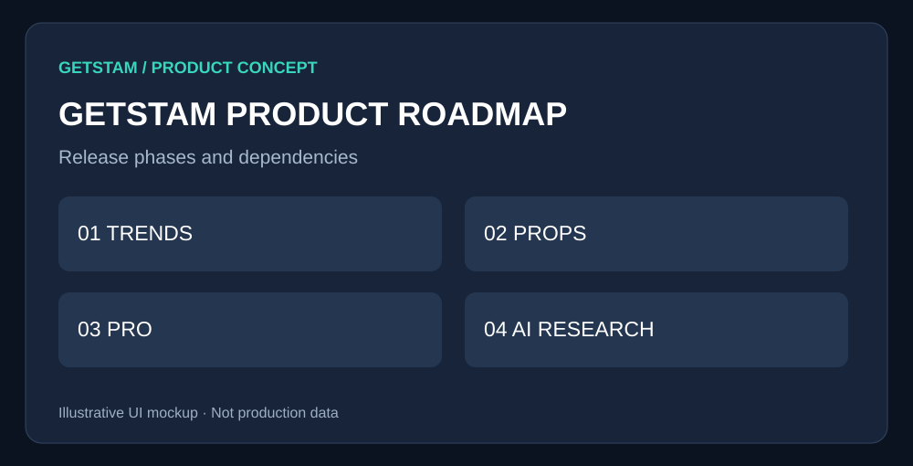

# Product Roadmap

> **GetSTAM product specification** · Draft for review · October 2026  
> **Visuals are conceptual mockups, not production screenshots or live data.**

## 1. Overview

Sequence the existing advanced trends release, player props, subscriptions, and AI research into measurable product milestones.

## 2. Proposed user interface

*Figure 1 — Proposed GetSTAM interface. Visual elements and figures are illustrative.*

### How a user would experience this

First release accurate advanced trends without breaking free features. Validate engagement with player props, test subscription demand, and launch evidence-backed AI only after reliable data and billing.

## 3. Feature comparison

| Feature | Status | Priority |
|---|---|---|
| Advanced trends | Existing branch | P0 |\n| Player prop analyzer | Proposed | P1 |\n| GetSTAM Pro | Proposed | P2 |\n| AI research assistant | Proposed | P2 |

## 4. Product and implementation notes

Epic [#111](https://github.com/getstaminc/get-stam-py/issues/111) reconciles `feature/advanced-trends-analytics-add-overview` with `main`. Keep separate feature branches and review PRs; never auto-merge.

## 5. Acceptance criteria

Each phase needs approved UI, accurate data, automated tests, metrics, and a rollback plan.

## 6. Detailed technical planning

# 05 — GetSTAM Product Roadmap and Release Plan

**Status:** Planning document · **Last updated:** 2026-10-22

## Product strategy
Keep scores, odds, and foundational historical trends free. Charge for research workflows that save time: detailed player prop analysis, custom trend exploration, alerts, and evidence-backed AI.

## Sequence
| Phase | Initiative | Deliverable | Gate |
|---|---|---|---|
| 1 | [Advanced Trends Epic #111](https://github.com/getstaminc/get-stam-py/issues/111) | Safely reconcile and release branch `feature/advanced-trends-analytics-add-overview` | Accuracy, tests, responsive UI, free-feature regression |
| 2 | [Player Prop Analyzer](02-player-props.md) | Searchable game logs, line-relative hit rates, filters | Source quality and user engagement |
| 3 | [GetSTAM Pro](03-getstam-pro.md) | Subscription billing and entitlements | Paid beta and economics |
| 4 | [AI Research Assistant](04-ai-research-assistant.md) | Auditable conversational research | Correctness, costs, and safety |
| 5 | Alerts and saved workflows | Retention tools | Demand and notification consent |

## Advanced Trends scope (existing work)
- Preserve production features.
- Reconcile branch with `main` before merging: branch histories have diverged.
- Review collision sample construction, overlapping historical observations, and aggregation.
- Do **not** label blended historical rates as calibrated probabilities or statistical confidence without validation.
- Approve responsive mockups and regression tests before release.
- Reference issue #111 and linked child issues in implementation PRs.

## Monetization experiments
- Test $14.99/month Pro positioning as a **hypothesis**, not a promise.
- Instrument advanced feature views, signup intent, upgrade clicks, paid conversion, 30/60/90-day retention, and cancellation reasons.
- Estimate contribution margin after data/API/AI, infrastructure, payment processing, and support costs.
- Avoid adding a paywall to core production functionality without a separate decision.

## Definition of done for each feature
1. Clear user problem and approved UX.
2. Data availability and licensing confirmed.
3. Documented API/data contract and edge cases.
4. Automated tests and responsive accessibility checks.
5. Analytics, monitoring, rollback, and release notes.
6. Free/Pro entitlement decision recorded.
7. Product owner approval; no automatic merge or deployment.

## Open decisions
Which sport and market launch first? Which features users most frequently revisit? Which data rights permit paid redistribution? What usage limits fit margins? What is the minimum acceptable historical sample?

## Related documents
[02 Player Props](02-player-props.md) · [03 GetSTAM Pro](03-getstam-pro.md) · [04 AI Assistant](04-ai-research-assistant.md)

---

**Review checklist:** Confirm feature scope, visual design, free/paid boundary, and acceptance criteria before implementation.
